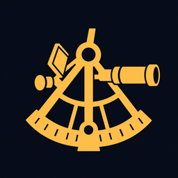
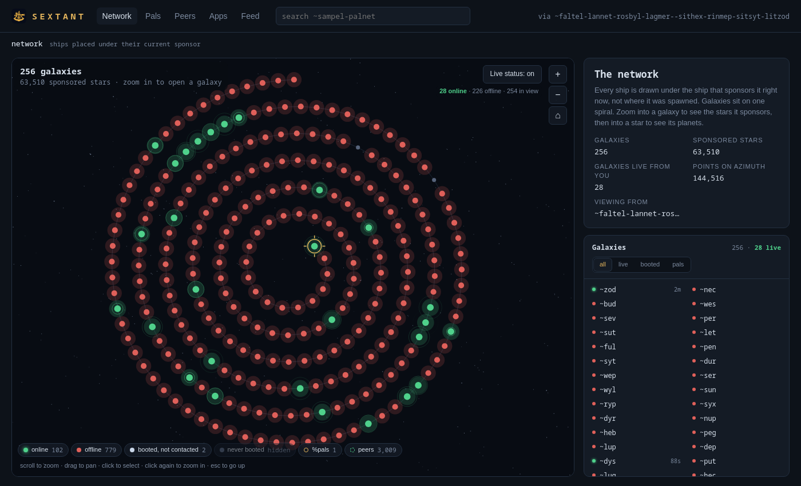
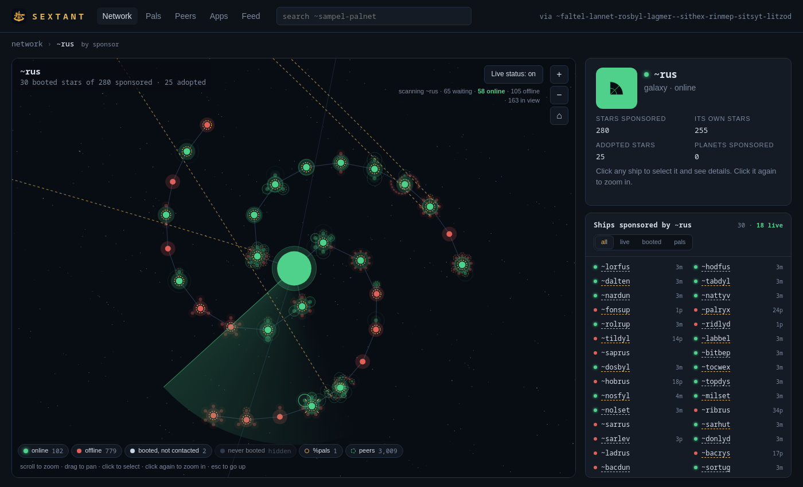
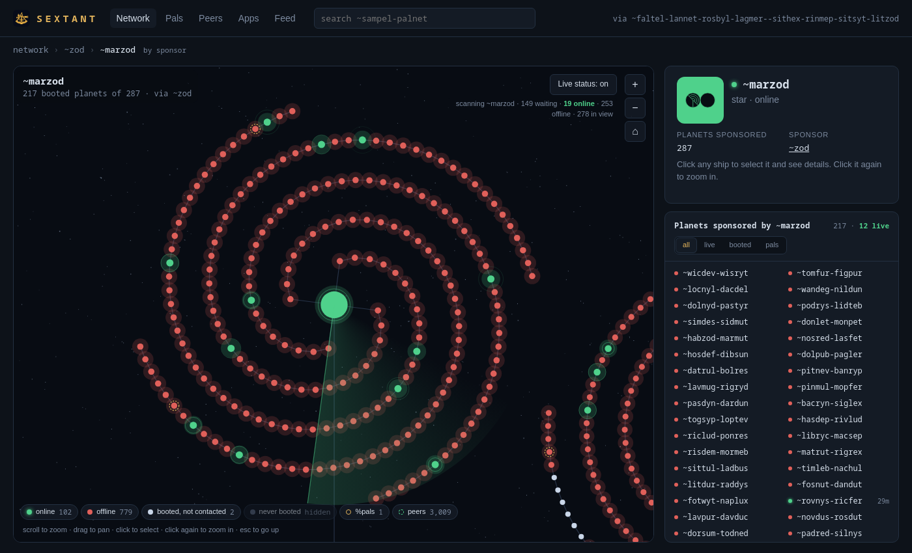
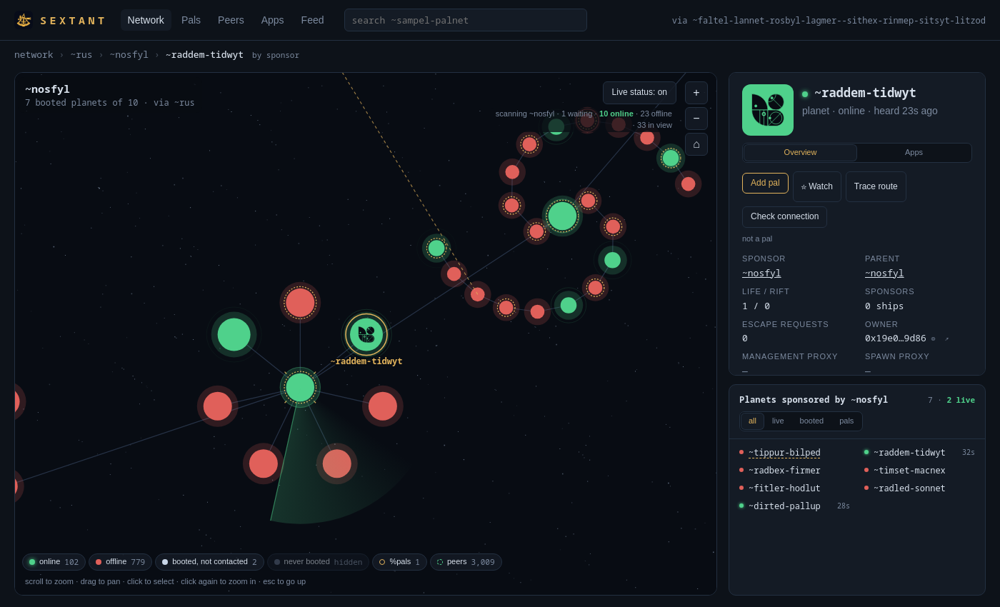
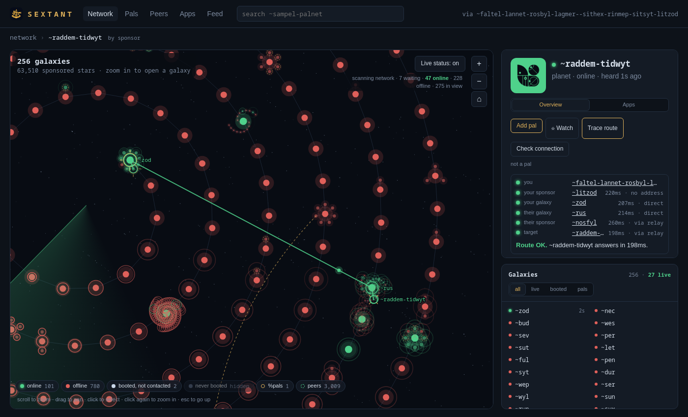
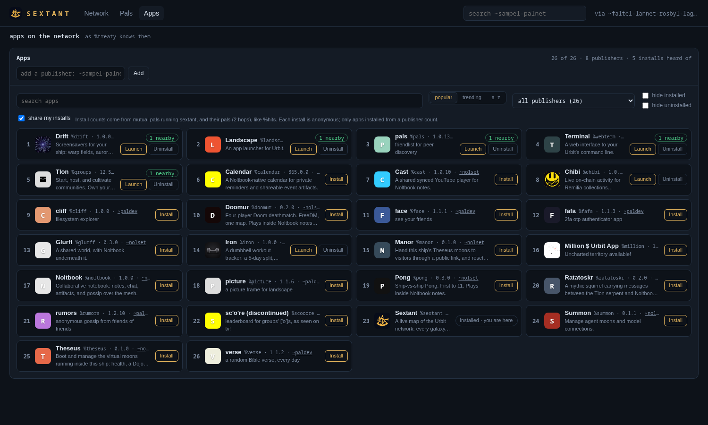
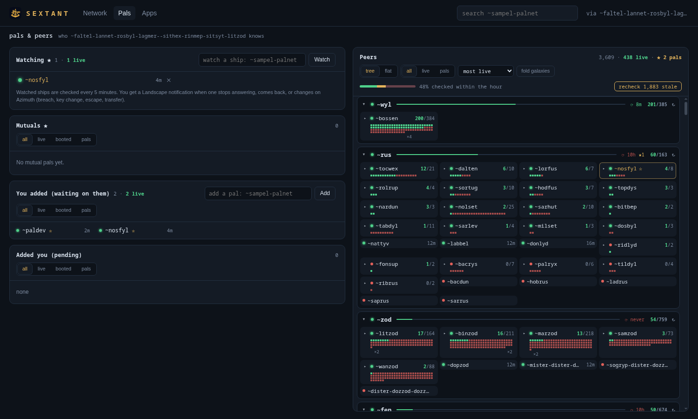
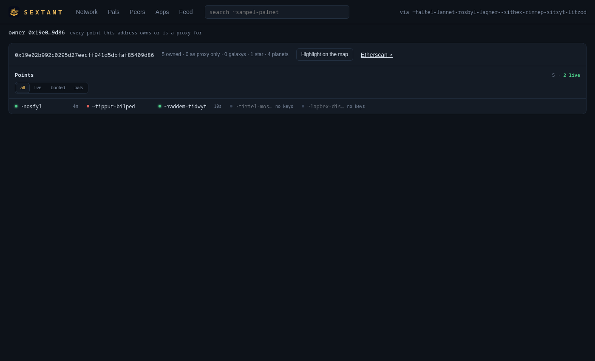

<p align="center">
  
</p>

<h1 align="center">%sextant</h1>

<p align="center">
  A live map of the Urbit network for your ship.<br>
  Every galaxy, star, planet and known moon, drawn under the ship that sponsors it <em>right now</em>,<br>
  with live status, route tracing, an Azimuth event feed, and the apps your pals use.
</p>

<p align="center">
  <code>|install ~nosfyl %sextant</code>
</p>



## What it does

Sextant reads the Azimuth state your ship already keeps and draws the whole network as one zoomable chart:

- **Galaxies** sit on a single Archimedean spiral, evenly spaced, with `~zod` at the centre.
- **Zoom into a galaxy** to see the stars it currently sponsors, winding into it on two, three or four spiral arms. Their planets show up around them as you zoom, so you can see how busy each star's neighbourhood is.
- **Zoom into a star** to see its planets, laid out the same way. Planets load from your ship only once you zoom close enough to see them.
- **Moons** your ship has talked to (including your own, which ping their planet) sit on spokes around their planet, star or galaxy.
- **Ships are placed by sponsor, not by parent.** A star that escaped to another galaxy sits under its new sponsor and gets a dashed gold ring. **Pending escape requests** are drawn as dashed gold arcs to the sponsor they asked for.
- **Names** stay off the map until you hover over a ship or select it.

| A galaxy and the stars it sponsors | A star and its planets |
|---|---|
|  |  |

### Live status

Ames can't tell you who is online: it only learns about a ship when packets flow, and it marks any idle peer "dead" 30 seconds after the last one. So Sextant asks.

- While the map is open, every booted ship on screen gets one small **remote-scry request** for the hash of its public `%kids` desk. Any answer means **online** (green); no answer within 20 seconds means **offline** (red), and the request is cancelled so nothing keeps retrying in ames.
- A **radar sweep** turns over the galaxy or star in view while answers are pending, and each ship changes colour as the sweep line passes over it.
- Each ship **keeps its last result** until the next check finishes, so a re-check never blanks the map.
- It's polite about traffic: ships that answer are re-checked at most every 5 minutes; silent ones back off to 15 minutes, an hour, 6 hours, then once a day; and at most 50 requests are out at once. In the background only your pals, your watched ships and the galaxies are kept fresh. The **Live status** button on the map pauses it all.

### Ship details

Click any ship to select it. Click it again to zoom in.

- Its **sigil** on its status colour, its sponsor, parent, keys and escape requests, and its owner and proxy addresses (copy, open on Etherscan, or **◎** to see everything that address controls).
- **%pals:** whether you're mutuals, whether they got your request, and add or remove them in one click.
- **☆ Watch:** get a Landscape notification when the ship stops answering, comes back, or changes on Azimuth. Watched ships are checked every 5 minutes and wear a small marker on the map.
- **Trace route** (below).
- **Check connection** runs a `%vitals` check for a full diagnosis.
- **Apps:** the desks a ship publishes, via `%treaty`, with install buttons.

| Selected ship | Route trace |
|---|---|
|  |  |

### Route tracer

**Trace route** follows the path a packet takes from you to a ship: up your sponsor chain to where it meets theirs, then down to them. It checks every hop at once and shows, for each one, whether it answered, its round trip, and whether your ship has a direct address for it, only reaches it through relays, or has no address at all (a galaxy with no DNS entry). The route is drawn on the map with a pulse running along the part that works, and the panel says where and why it breaks.

If a hop is silent but a ship behind it answered, that hop is up and has probably just never heard of your ship (common for brand-new comets). Sextant offers to **Say hi** to it, the same as `|hi`.

### Apps on the network



The **Apps** tab lists every app your ship knows is published, from the publishers it follows through `%treaty`. Search them, pick a publisher from the dropdown, **hide installed** or **hide uninstalled**, install with a click, or **add a publisher** by name to see what it offers.

Apps you have get **Launch** and **Uninstall**. Launch opens the app inside Sextant, under its top bar, with a tab of its own next to Network, Pals and Apps. Several can be open at once and stay loaded while you look at the map; the tabs fit their names, and the strip scrolls once it fills. ✕ (or Esc) closes one and takes you back to where you opened it. Uninstall is the same as `|uninstall`: the app stops and its data stays, so reinstalling brings it back.

**Popular with your pals.** Like [`%hits`](https://github.com/iko-soy/hits), Sextant gossips installs: each app you installed *from a publisher* is one anonymous "hit", shared with your mutual pals who run Sextant and relayed one more hop to theirs (via [`/lib/gossip`](https://github.com/fang-/suite)). Each install carries a random id, so relayed copies count once and an uninstall takes its hit back. The Apps tab can then rank apps as **popular** (installs heard of nearby) or **trending** (each install counts half as much each day), and shows apps you only know about through pals. Desks you made yourself (`|new-desk`, or installed from a file) are never shared, and **share my installs** turns it off.

### Pals and peers



The **Pals** tab puts the ships you care about on one page:

- **Watching ★** at the top: add a ship by name, see each one's status, and ✕ to stop. You get a Landscape notification when a watched ship stops answering, comes back, or changes on Azimuth.
- **%pals** below it: mutuals, the pals you added (with a box to add more), and the ones who added you.
- **Peers** on the right: every ship your ship has talked to, packed into a grid. Each galaxy is a band, open by default, with a bar for how much of it is live. Its stars are tiles with one pip per peer under them (live first, and in proportion once a pip stands for several ships); open a tile to spread its planets out as chips. Sort by most live, most peers, last answered or name; filter to live ships or pals; or flip to one flat list. Pals are outlined: ★ mutual, ☆ you added them, ⇠ they added you.

**Is the count current?** Each galaxy band shows how long since its stalest peer was checked (green within 15 minutes, gold within the hour, red after that or never), and the header shows how much of the list was checked within the hour. **Recheck stale** asks every peer that's gone an hour without a check, stalest first; the **↻** on a band rechecks that galaxy now. A recheck keeps about 45 requests out at once and tops up as answers land, and the counts update as it goes. Asking a ship makes it a peer, so rechecking also grows the list with ships your ship hadn't heard from.

### Azimuth feed and owners

The **Feed** sits under the ship list on the Network page: what `%azimuth` reports as it happens, filtered by kind. Breaches, first boots and key changes, escape requests and cancellations, completed escapes, transfers and moves to layer 2. New events also pop up on the map, and a completed escape glides the ship over to its new sponsor.

Click **◎** next to any address, or search for an `0x…` address, to see every point it owns or is a proxy for, and highlight them on the map.



### Finding ships

- **Search** suggests galaxies, stars, loaded planets, your pals and your peers as you type, and accepts Ethereum addresses.
- The **legend** filters the map by status, pals, or peers (the ships your ship has talked to, plus the galaxies and stars they live under).


## Install

From your ship's dojo:

```
|install ~nosfyl %sextant
```

Or search for `~nosfyl` in Landscape and install Sextant from there. Then open it from your Landscape home screen, or go to `/apps/sextant` on your ship.

Sextant needs `%azimuth`, which every planet and star already runs. `%pals`, `%vitals`, `%treaty`, `%docket` and `%hark` (all part of a normal Landscape install) are used if you have them.

### Let others browse your map

By default only you (logged in) can see your Sextant. To let anyone view it read-only:

```
:sextant [%public &]
```

Adding pals, checks, traces, app lookups, installs, watching and sharing settings always need the owner's login.

## How it works

Everything comes from your own ship. Sextant doesn't call any outside services.

| Source | Used for |
|---|---|
| `%azimuth` | points, keys, sponsors, escape requests, owners; the `/event` stream for the feed |
| remote scry | live status: one cancellable request per ship for its `%kids` desk hash |
| `%ames` | which ships and moons your ship knows, and how it reaches them (for the tracer) |
| `%pals` + `/lib/gossip` | pals, and sharing app installs with mutuals and theirs |
| `%treaty`, `%docket`, `%hood` | published apps, installed apps and their sources, installing |
| `%hark` | notifications for watched ships |
| `%vitals` | full connection diagnoses |

The agent caches the full sponsorship tree (256 galaxies and every sponsored star, about 1.7 MB) and rebuilds it within a minute of anything changing, so the map opens instantly. A star's planets come from a separate request when you zoom in.

**Layout.** Every level uses the same Archimedean spiral, r = bθ, with points at equal arc length. The gap between turns is a fixed multiple of the gap between neighbours, solved so that N points exactly fill the disc, so every ship sits the same distance from its neighbours along its arm and from the arms beside it. Each ship's children live in a disc just under half that spacing, so discs never overlap.

## API

All routes are under `/apps/sextant/api` and return JSON. Owner-only routes need you to be logged in to the ship, even when public mode is on.

| Route | What |
|---|---|
| `GET /me` | host ship, what's installed, point count |
| `GET /tree` | every galaxy and every sponsored star as compact rows (cached) |
| `GET /ship/~p` | one point in detail: sponsor, chain, keys, proxies, pal receipt |
| `GET /residents/~p` | ships `~p` sponsors, plus pending escape requests |
| `GET /pals`, `GET /peers` | your pals; every ship (and moon) your ship has talked to, with when each was last checked |
| `POST /status` | `["~zod", …]` → `{ship: [status, last, waiting]}`; the owner's reads also probe ships that are due |
| `POST /recheck` | `["~zod", …]`: probe these now, even if checked lately or backing off, but at most 50 out at once; answers the ships it sent (owner) |
| `POST /trace/~p`, `GET /trace/~p` | probe every hop between you and `~p` (owner); the hops with status, round trip and address kind |
| `POST /hi/~p` | say hi to `~p`, like `\|hi` (owner) |
| `GET /catalog` | every known published app, the publishers you follow, and gossiped install counts |
| `GET /apps/~p` | apps `~p` publishes, via `%treaty` |
| `POST /apps/~p` | follow `~p` as a publisher through `%treaty` (owner) |
| `POST /install/~p/desk` | install a desk from `~p`, reviving it if it was uninstalled (owner) |
| `POST /uninstall/desk` | uninstall one of your desks, like `\|uninstall`; not `%base` or Sextant itself (owner) |
| `POST /share/on`, `/share/off` | share your app installs with pals, or not (owner) |
| `GET /events` | recent Azimuth events, newest first |
| `GET /owner/0x…` | every point an address owns or is a proxy for |
| `GET /watch`, `POST /watch/~p`, `DELETE /watch/~p` | watched ships; watch or unwatch (owner) |
| `GET /ping/~p`, `POST /ping/~p` | latest `%vitals` result; start a check (owner) |
| `POST /pal/~p`, `DELETE /pal/~p` | add or remove a pal (owner) |

## Development

```
desk/
  app/sextant.hoon   agent: JSON API, probes, gossip, feed, cached tree
  lib/gossip.hoon    from fang-/suite (with lib/pals, sur/pals, lib/verb, sur/verb, mar/gossip)
  web/               index.html, app.js (canvas map), style.css, sigil.js, icon.png
  desk.docket-0      Landscape tile
dev.sh               copy desk/ into a pier and |commit
```

On a fake ship or comet:

```
|new-desk %sextant
|mount %sextant
```

Then, after each edit:

```sh
./dev.sh <pier-dir> <tmux-session-running-the-ship>
```

The first time, run `|install our %sextant` in the dojo.

To publish from your own ship, copy `desk/*` into `<pier>/sextant/`, then run:

```
|commit %sextant
|install our %sextant
:treaty|publish %sextant
```

`web/sigil.js` is [`@urbit/sigil-js`](https://github.com/urbit/sigil-js) 2.2.0 (MIT), vendored as a plain script. `lib/gossip.hoon` and its dependencies are from [fang-/suite](https://github.com/fang-/suite) (MIT, see [licenses/](licenses/)).

## License

MIT. See [LICENSE](LICENSE).
