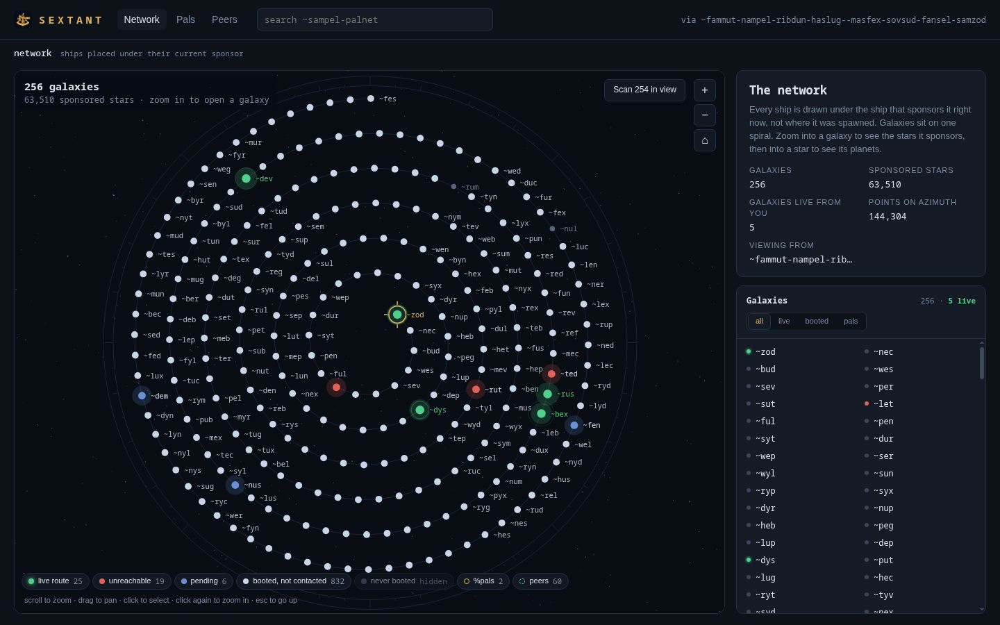
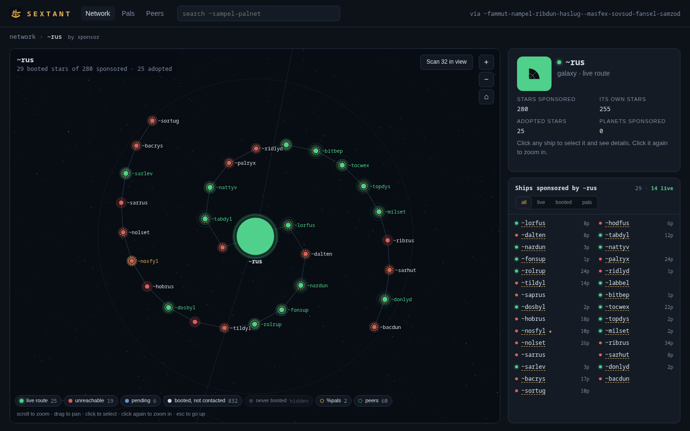
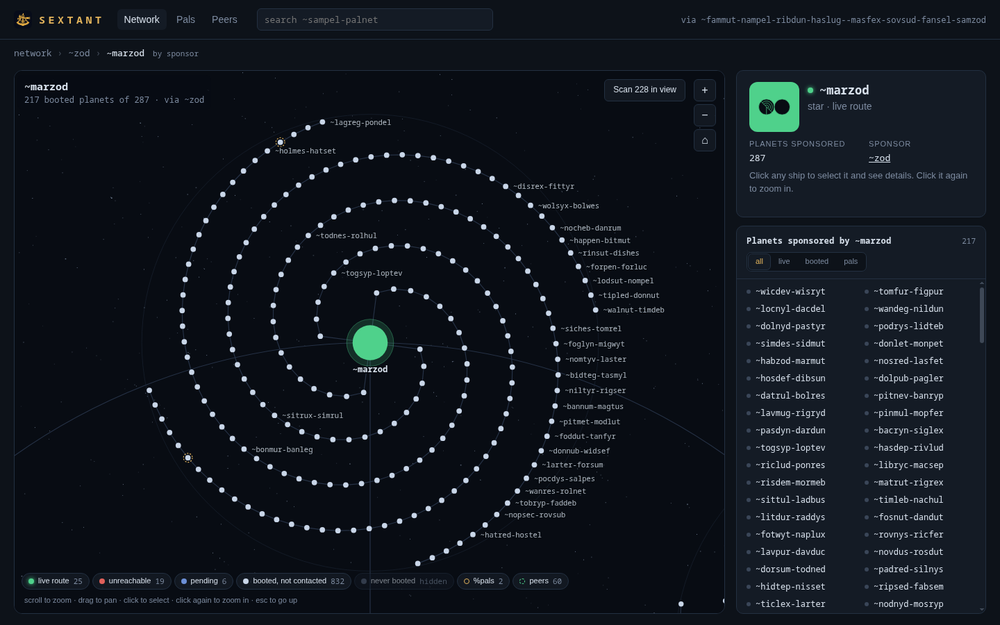
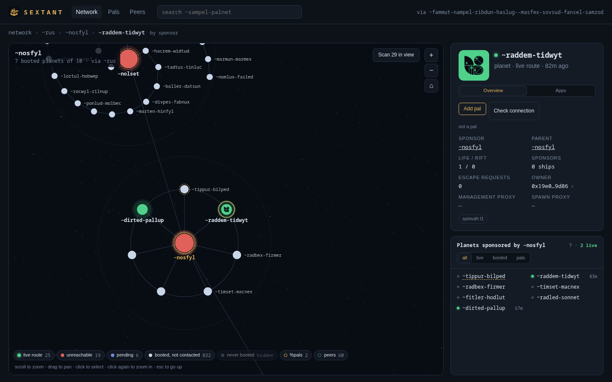
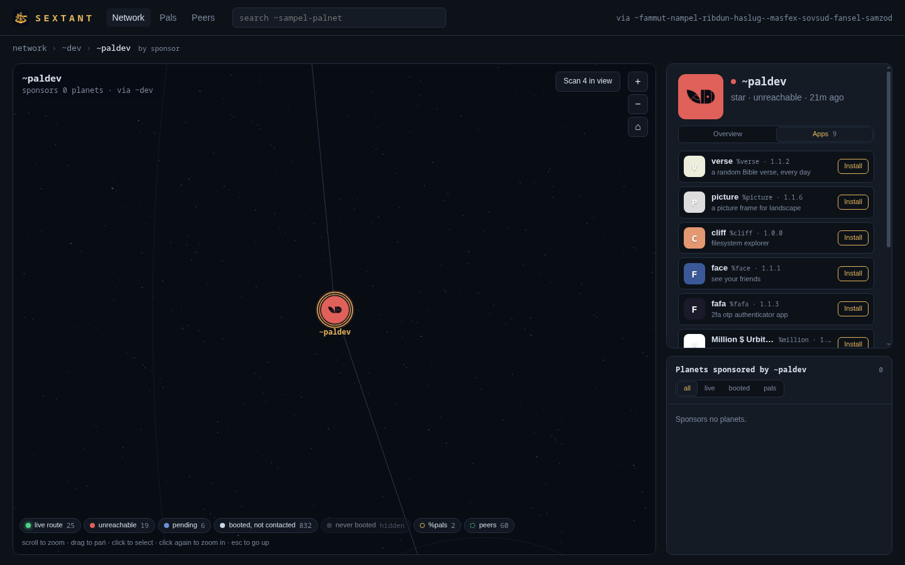
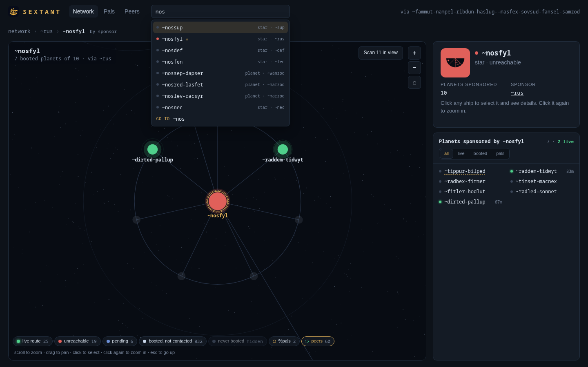

<p align="center">
  
</p>

<h1 align="center">%sextant</h1>

<p align="center">
  A live map of the Urbit network for your ship.<br>
  Every galaxy, star and planet, drawn under the ship that sponsors it <em>right now</em>.
</p>

<p align="center">
  <code>|install ~nosfyl %sextant</code>
</p>



## What it does

Sextant reads the Azimuth state your ship already keeps and draws the whole network as one zoomable chart:

- **Galaxies** sit on a single Archimedean spiral, evenly spaced, with `~zod` at the centre.
- **Zoom into a galaxy** to see the stars it currently sponsors. They wind into it on two, three or four spiral arms; a galaxy with only a few stars spreads them evenly on a circle.
- **Zoom into a star** to see its planets, laid out the same way. Planets load from your ship only once you zoom close enough to see them.
- **Ships are placed by sponsor, not by parent.** A star that escaped to another galaxy sits under its new sponsor and gets a dashed gold ring. `~rus`, for example, has adopted 25 stars from other galaxies.
- **Colours are live** from your ship's own networking state: green is a live route, red is unreachable, blue is pending, white is booted but not contacted yet. Ships that were spawned but never booted are hidden by default (there's a toggle in the legend).

| A galaxy and the stars it sponsors | A star and its planets |
|---|---|
|  |  |

### Ship details

Click any ship to select it. Click it again to zoom in.

- The ship's **sigil** sits on its status colour.
- **Sponsor, parent, keys and escape requests**, plus owner and proxy addresses. Click an address to copy it, or use ↗ to open it on Etherscan.
- **%pals:** see whether you're mutuals, whether they got your request, and add or remove them in one click.
- **Check connection** runs a `%vitals` check, which tells you whether the ship is reachable and, if not, whether it's your side, theirs, or their sponsor's.
- **Apps:** look up the desks a ship publishes (via `%treaty`, the same as searching it in Landscape) and install them from there.

| Selected ship | Apps it publishes |
|---|---|
|  |  |

### Finding ships and who's online

- **Search** suggests galaxies, stars, loaded planets, your pals and your peers as you type.
- The **peers** layer keeps only the ships your ship has talked to, plus the galaxies and stars they live under.
- **Scan in view** runs a `%vitals` check on the booted ships currently on screen, six at a time, and paints the results as they arrive. Nothing keeps a global list of who is online: your ship only knows about ships it has exchanged packets with, so a scan is the honest way to find out. It sends traffic to those ships, so it only runs when you click it.



## Install

From your ship's dojo:

```
|install ~nosfyl %sextant
```

Or search for `~nosfyl` in Landscape and install Sextant from there. Then open it from your Landscape home screen, or go to `/apps/sextant` on your ship.

Sextant needs `%azimuth`, which every planet and star already runs. `%pals`, `%vitals` (part of Landscape) and `%treaty` are used if you have them.

### Let others browse your map

By default only you (logged in) can see your Sextant. To let anyone view it read-only:

```
:sextant [%public &]
```

Adding pals, connection checks, scans, app lookups and installs always need the owner's login.

## How it works

Everything comes from your own ship's scries. Sextant doesn't call any outside services.

| Source | Used for |
|---|---|
| `%azimuth` | points, keys, sponsors and escape requests |
| `%ames` | which ships your ship knows, and whether the route is live |
| `%pals` | targets, leeches, and whether your requests were received |
| `%vitals` | active connection checks |
| `%treaty`, `%hood` | apps a ship publishes, and installing them |

The agent builds the full sponsorship tree (256 galaxies and every sponsored star, about 1.7 MB) on a five-minute timer and serves the cached copy, so the map opens instantly. A star's planets come from a separate request when you zoom in.

**Layout.** Every level uses the same Archimedean spiral, r = bθ, with points at equal arc length. The gap between turns is a fixed multiple of the gap between neighbours, and it's solved so that N points exactly fill the disc. As a result, every ship sits the same distance from its neighbours along its arm and from the arms beside it. Each ship's children live in a disc just under half that spacing, so discs never overlap.

## API

All routes are under `/apps/sextant/api` and return JSON. Owner-only routes need you to be logged in to the ship, even when public mode is on.

| Route | What |
|---|---|
| `GET /me` | host ship, what's installed, point count |
| `GET /tree` | every galaxy and every sponsored star as compact rows (cached) |
| `GET /ship/~p` | one point in detail: sponsor, chain, keys, proxies, pal receipt |
| `GET /residents/~p` | ships `~p` sponsors, plus pending escape requests |
| `GET /pals`, `GET /peers` | your pals; every ship your ship has talked to |
| `GET /apps/~p` | apps `~p` publishes, via `%treaty` |
| `POST /apps/~p` | look `~p` up through `%treaty` (owner) |
| `POST /install/~p/desk` | install a desk from `~p` (owner) |
| `GET /ping/~p`, `POST /ping/~p` | latest `%vitals` result; start a check (owner) |
| `POST /pal/~p`, `DELETE /pal/~p` | add or remove a pal (owner) |

## Development

```
desk/
  app/sextant.hoon   agent: JSON API, HTTP serving, cached sponsorship tree
  web/               index.html, app.js (canvas map), style.css, sigil.js, icon.png
  desk.docket-0      Landscape tile
dev.sh               copy desk/ into a pier and |commit
```

On a fake ship or comet:

```
|new-desk %sextant
|mount %sextant
```

Then, after each edit:

```sh
./dev.sh <pier-dir> <tmux-session-running-the-ship>
```

The first time, run `|install our %sextant` in the dojo.

To publish from your own ship, copy `desk/*` into `<pier>/sextant/`, then run:

```
|commit %sextant
|install our %sextant
:treaty|publish %sextant
```

`web/sigil.js` is [`@urbit/sigil-js`](https://github.com/urbit/sigil-js) 2.2.0 (MIT), vendored as a plain script.

## License

MIT. See [LICENSE](LICENSE).
